# RCESP32 — Coche RC FPV con ESP32-S3 (implementación y seguimiento)

## 1. Qué es el proyecto

Coche RC controlado desde el navegador. La **cámara** es el fondo de pantalla, el **HUD** va por encima y se conduce con **teclado, ratón/dedo o mando (PS4/Xbox)**. La ESP32-S3 recibe órdenes por **WebSocket** y mueve motor + servo.

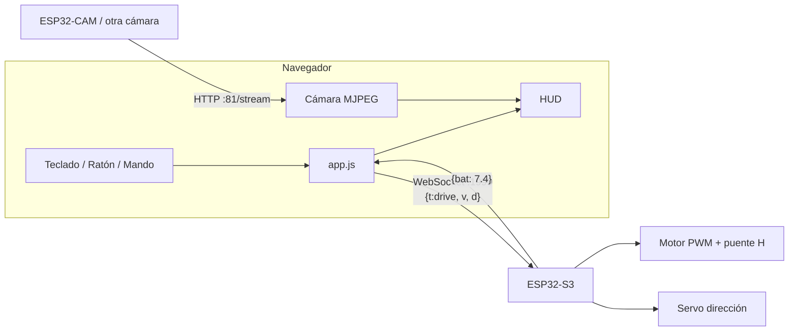

## 2. Estructura de archivos

```
RCESP32/
├─ platformio.ini
└─ src/
   ├─ main.cpp        ← firmware (ESQUELETO con TODO)
   ├─ Config.h        ← pines, puertos, ajustes (hecho)
   ├─ ClassCar.h/.cpp ← clase Car (ESQUELETO con TODO)
   ├─ index.html      ← cámara de fondo + HUD (hecho)
   ├─ style.css       ← estilos del HUD (hecho)
   ├─ app.js          ← punto de entrada del frontend (hecho)
   └─ js/
      ├─ config.js    ← constantes
      ├─ utils.js     ← $, clamp, dz
      ├─ socket.js    ← WebSocket
      ├─ camera.js    ← stream de cámara
      ├─ hud.js       ← actualización del HUD
      ├─ keyboard.js  ← entrada teclado
      ├─ mouse.js     ← entrada ratón/dedo
      └─ gamepad.js   ← entrada mando
```

## 3. Protocolo web ↔ coche

| Sentido | Mensaje | Significado |
|---|---|---|
| Web → ESP32 | `{"t":"drive","v":-100..100,"d":-100..100}` | `v` velocidad (+ adelante, − atrás); `d` dirección (− izq, + der) |
| ESP32 → Web | `{"bat":7.40}` | Voltaje de batería en voltios (cada `TELEMETRIA_MS`) |

> [!info] Por qué JSON
> Es fácil de depurar a ojo en el monitor serie y extensible (añadir `"luces"` mañana no rompe nada). Alternativa descartada: texto plano `"v,d"`, más ligero pero menos flexible.

## 4. Frontend (HECHO)

### 4.1 Bucle principal (`app.js`)

Cada frame (`requestAnimationFrame`) se lee cada fuente, se elige una por prioridad y se envía.

```javascript
const src = [gamepad, mouse, keys].find((s) => s.active) || { v: 0, d: 0 };
```

- **Prioridad mando > ratón > teclado:** evita que se pisen. Si nadie actúa → `(0,0)` = parado.
- **Latido:** aunque no cambie nada, se reenvía cada 250 ms para que el firmware detecte si se pierde el enlace.

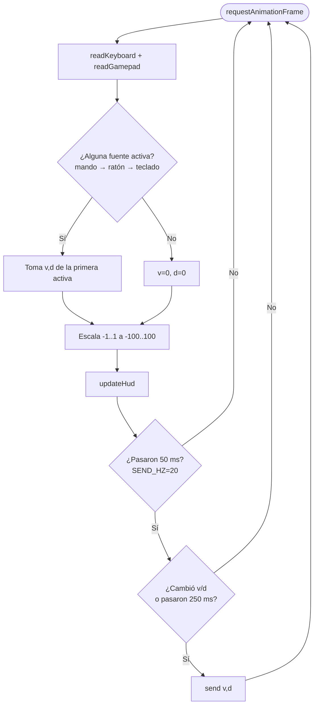

### 4.2 Teclado (`keyboard.js`)

Guarda en un `Set` las teclas pulsadas y en cada frame las traduce a `v,d`. Con `blur` se vacía el `Set`: si cambias de ventana con W pulsada nunca llegaría el `keyup` y el coche seguiría acelerando.

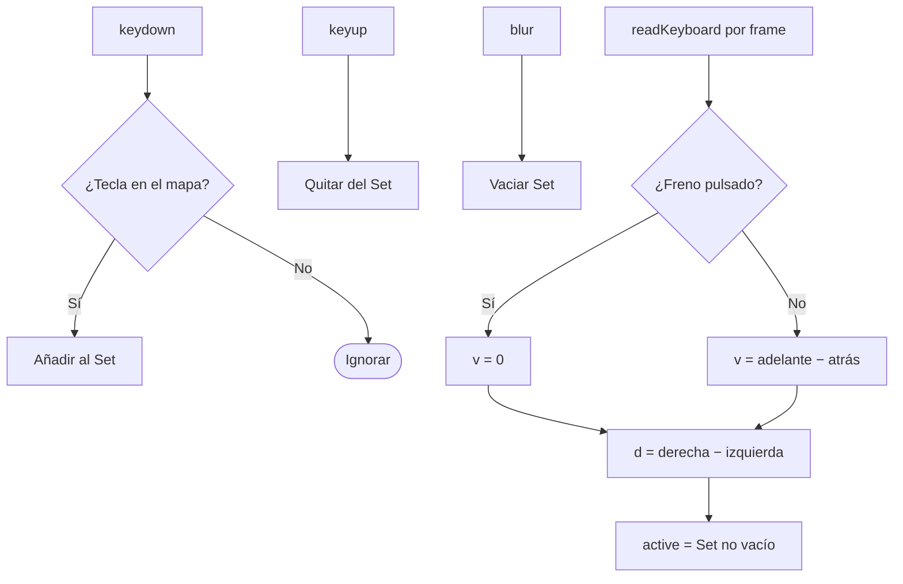

### 4.3 Ratón / dedo (`mouse.js`)

Joystick virtual: el punto donde haces clic es el **centro**; arrastrar arriba acelera, a los lados gira. `MOUSE_RADIUS` píxeles = 100 %.

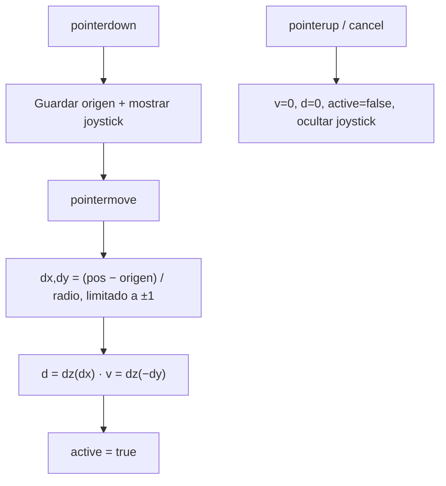

> [!warning] Trampa evitada
> `mouse` se **modifica** (`mouse.v = 0`), no se reasigna (`mouse = {...}`). Si se reasignara, `app.js` seguiría apuntando al objeto viejo, por cómo funcionan los `import` de ES modules.

### 4.4 Mando (`gamepad.js`)

La Gamepad API normaliza PS4 y Xbox al *standard mapping*:

| Control | Índice | Acción |
|---|---|---|
| Stick izq. X | `axes[0]` | Dirección |
| RT / R2 | `buttons[7]` | Acelerar |
| LT / L2 | `buttons[6]` | Marcha atrás |
| A / ✕ | `buttons[0]` | Freno |

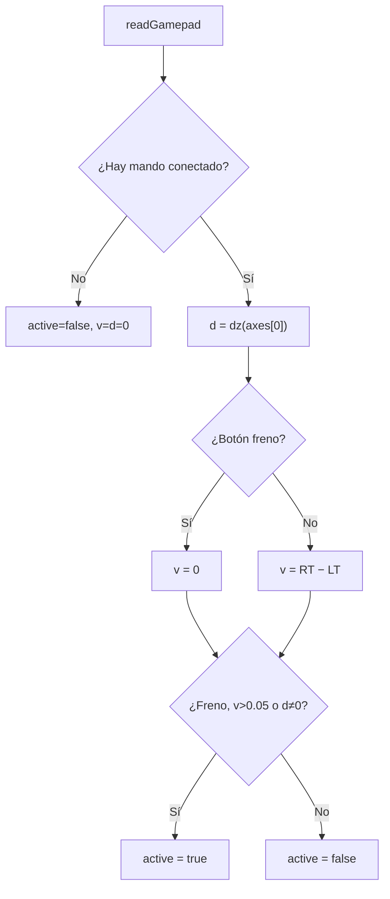

> [!info] ¿Por qué `active` sólo si se toca algo?
> Un stick suelto casi nunca marca exactamente 0. Sin esa condición el mando siempre ganaría la prioridad y anularía al teclado.

### 4.5 WebSocket (`socket.js`)

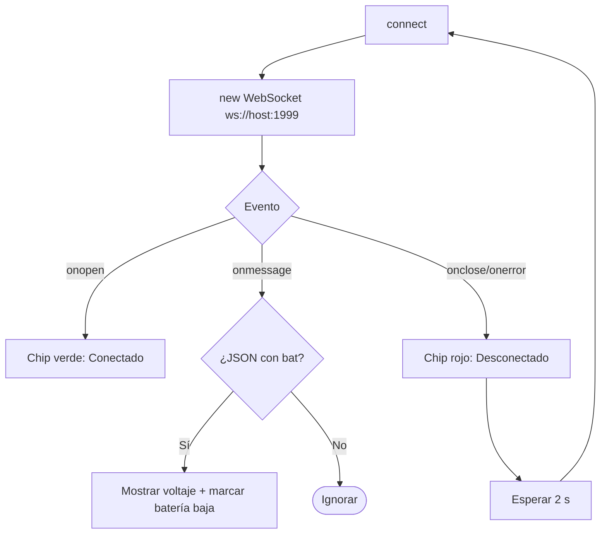

### 4.6 Cámara (`camera.js`)

`` a pantalla completa (`object-fit: cover`) con el stream MJPEG. Si falla, muestra "SIN SEÑAL" y reintenta cada 3 s. `?t=Date.now()` evita que la caché devuelva un fotograma viejo.

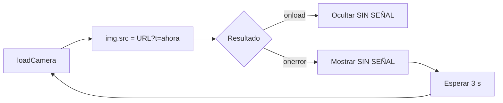

## 5. Firmware (ESQUELETO — pendiente de rellenar)

### 5.1 Clase `Car`

| Método | Estado | Idea |
|---|---|---|
| `begin()` | ⬜ TODO | `pinMode`, `ledcAttach`, `servo.attach` |
| `setVelocidad(v)` | ⬜ TODO | Sentido con `FWD/BWD`, PWM con `map(abs(v),0,100,0,1023)` |
| `setDireccion(d)` | ⬜ TODO | `map(d,-100,100,0,180)` y `servo.write` |
| `parar()` | ⬜ TODO | `setVelocidad(0)` + `setDireccion(0)` |
| `leerBateria()` | ⬜ TODO | `analogReadMilliVolts / 1000 * BAT_FACTOR` |

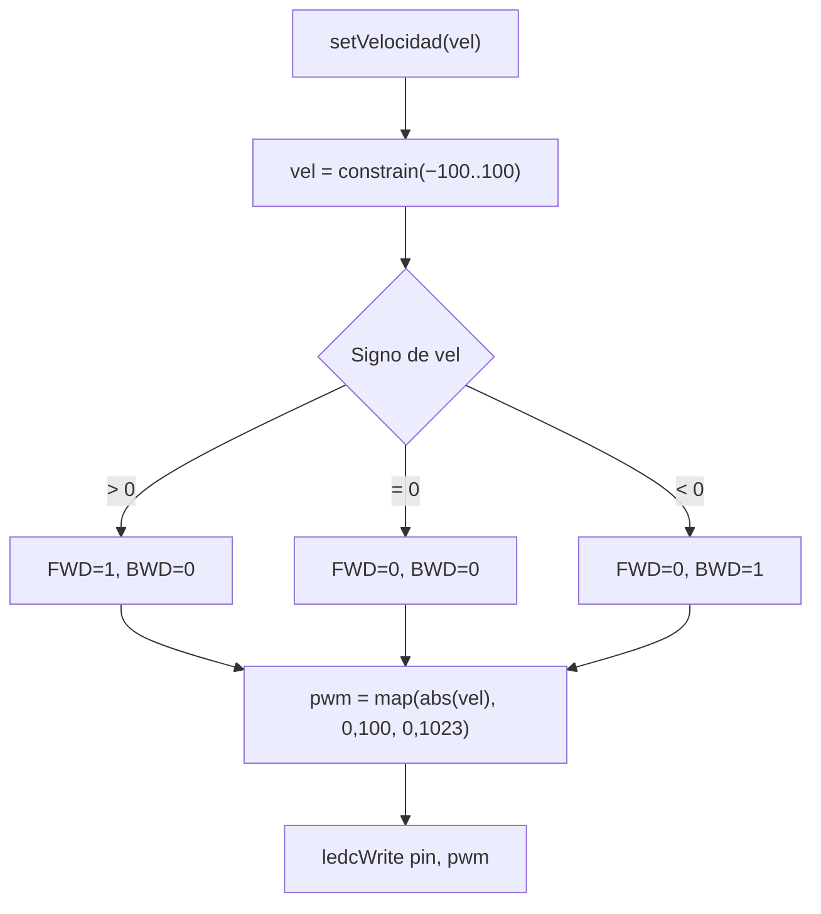

> [!bug] Fallos del código antiguo (ya documentados en los TODO)
> - En marcha atrás `map(vel,-100,0,0,1023)` **invertía** el PWM (−100 → 0, 0 → 1023). Solución: usar `abs(vel)`.
> - El pin y el valor PWM compartían variable (`_motorVel`), así que se pisaban.
> - `set_direccion` calculaba el ángulo pero no movía el servo.

### 5.2 `main.cpp`

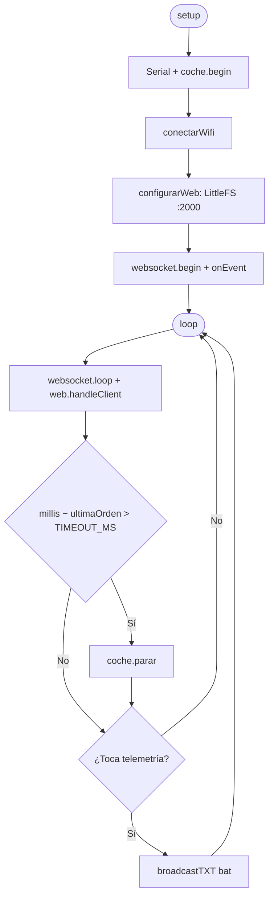

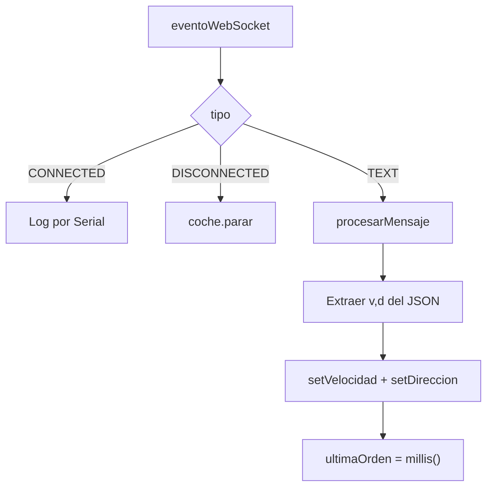

> [!warning] Seguridad: fail-safe
> Dos mecanismos independientes paran el coche: (1) cliente desconectado, (2) más de `TIMEOUT_MS` (500 ms) sin órdenes. La web reenvía cada 250 ms, así que 500 ms de silencio = enlace perdido.

## 6. Esquema completo del sistema

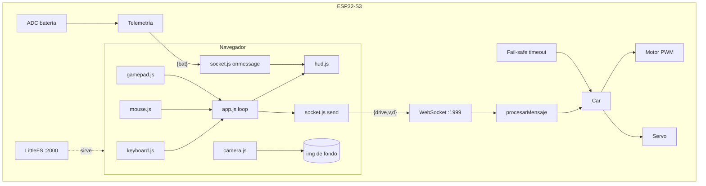

## 7. Seguimiento

### Hecho ✅
- [x] Interfaz FPV: cámara de fondo + HUD (conexión, batería, mira, dirección, acelerador, joystick virtual)
- [x] Entrada por teclado, ratón/dedo y mando PS4/Xbox con prioridades
- [x] Cliente WebSocket con reconexión y telemetría de batería
- [x] Frontend dividido en módulos ES (`js/`)
- [x] `Config.h` corregido (guardas, `constexpr`, sin globales en el header)
- [x] Esqueletos de `Car` y `main.cpp` con TODO

### Pendiente ⬜
- [ ] `ClassCar.cpp`: `begin`, `setVelocidad`, `setDireccion`, `parar`, `leerBateria`
- [ ] `main.cpp`: WiFi, WebSocket, parseo del JSON, fail-safe, telemetría
- [ ] Rellenar `SSID` / `PASSWIFI` y calibrar `BAT_FACTOR`
- [ ] Carpeta `data/` (con `js/` incluida) + `board_build.filesystem = littlefs` + subir imagen
- [ ] Servir la web (`configurarWeb`)
- [ ] Decidir fuente de cámara (la Matrixportal S3 no tiene) y ajustar `CAMERA_URL`
- [ ] Probar con el mando real (verificar índices en PS4 vs Xbox)
- [ ] Subir `monitor_speed = 115200` a `platformio.ini`

### Ideas futuras 💡
- Modo AP (`WiFi.softAP`) para usarlo sin router
- Botones de luces/claxon (`{"t":"action"}`)
- Pantalla completa y orientación forzada en móvil
- Curva exponencial en el acelerador para más control fino

## 8. Ejercicios prácticos

**Ejercicio 1.** El ratón tiene `MOUSE_RADIUS = 120`. Si arrastras 60 px hacia arriba, ¿qué `v` se envía? (zona muerta 0,12)

> [!success]- Respuesta
> **v = 50**. Cálculo: `dy = −60/120 = −0,5` → `v = dz(0,5) = 0,5` (> 0,12) → `0,5 × 100 = 50`.
> El radio es el desplazamiento para llegar al 100 %, así que 60 px es la mitad del recorrido.

**Ejercicio 2.** `setVelocidad(-50)`: ¿qué valen `FWD`, `BWD` y el PWM?

> [!success]- Respuesta
> `FWD=0`, `BWD=1`, `pwm = map(abs(-50),0,100,0,1023) ≈ 511`. Se usa `abs()` porque el sentido ya lo decide el puente H; el PWM sólo indica *cuánto*.

**Ejercicio 3.** Estás conduciendo con W pulsada y haces Alt+Tab. ¿Qué evita que el coche siga acelerando?

> [!success]- Respuesta
> El evento `blur` vacía el `Set` de teclas. Además, aunque la web se bloqueara, el firmware pararía el coche tras `TIMEOUT_MS` sin órdenes.

**Ejercicio 4.** ¿Por qué `mouse` se modifica en vez de reasignarse en `endDrag`?

> [!success]- Respuesta
> Los `import` de ES modules son referencias al objeto exportado. Si se reasigna la variable en el módulo, `app.js` conserva el objeto antiguo y nunca ve el valor nuevo.

## 9. Cheatsheet

| Concepto | Valor |
|---|---|
| WebSocket | `ws://IP:1999` |
| Web | `http://IP:2000` |
| Cámara | `http://IP:81/stream` |
| Comando | `{"t":"drive","v":-100..100,"d":-100..100}` |
| Telemetría | `{"bat":7.4}` |
| Envío | 20 Hz + latido 250 ms |
| Fail-safe | 500 ms sin órdenes |
| PWM | 10 bits (0–1023), 1 kHz |
| Mando | RT=7, LT=6, A/✕=0, stick X=axes[0] |

## 10. Recuerda

- **Seguridad primero:** el coche debe pararse solo ante cualquier pérdida de enlace.
- El frontend usa **módulos ES**: necesita servirse por HTTP, no abrirse con `file://`.
- Mover `js/` entera a `data/` al subir a LittleFS.
- Un stick nunca marca 0 exacto: usa siempre **zona muerta**.
- Usa `abs()` para el PWM; el signo ya está en el puente H.
- Evita `delay()` en el `loop` del ESP32 o el WebSocket dejará de atender.
